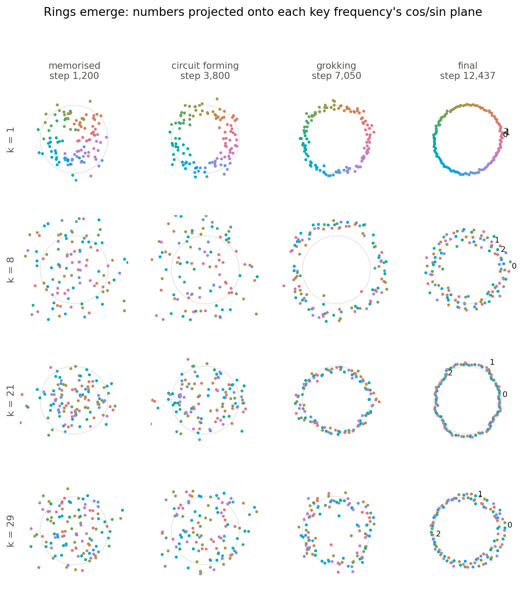

# Watching a transformer grok

A replication of [Nanda et al. (2023)](https://arxiv.org/abs/2301.05217): a one-layer transformer
trained on `(a + b) mod 113` memorises, then groks, as a Fourier-based algorithm forms in its weights.

**Interactive write-up:** https://jpganis.com/grokking/



## Run it

```sh
python -m grokking.train      # train and save checkpoints to runs/p113_seed0
python -m grokking.analyse    # progress measures, figures/ and docs/data/
```

`docs/` is the static site (D3, no build step). Serve it with `python -m http.server -d docs`.
